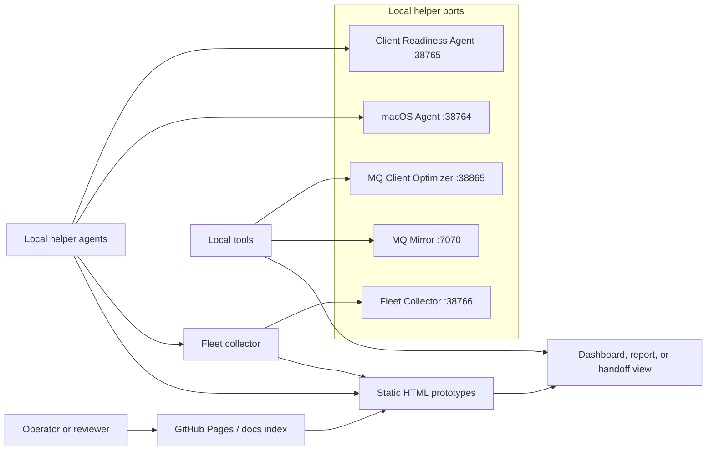

# Architecture Diagram

Design-Prototype uses a browser-first prototype model: most public demos are
static HTML files with embedded demo data, while optional local helper agents
provide live endpoint or fleet signals.

## Read path

1. A reviewer opens the GitHub Pages front door or a local HTML file.
2. The prototype loads bundled demo data by default.
3. If a helper endpoint is reachable, the dashboard can use live data.
4. Operators use the visible status, checks, and recommendations for triage or
   handoff.

## Safety boundary

Public docs, screenshots, and GitHub issues should use demo data or redacted
helper output. Live helper responses can include hostnames, usernames, IP
addresses, certificate subjects, and serial numbers.
