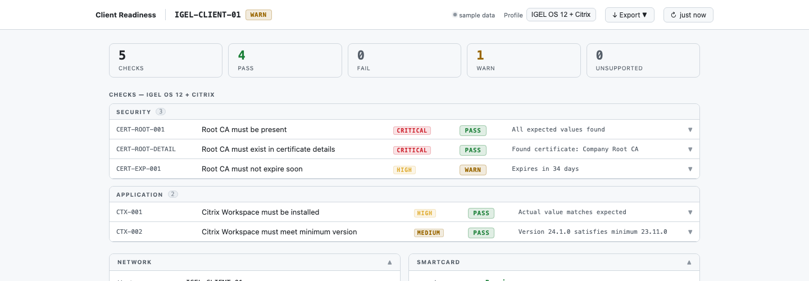
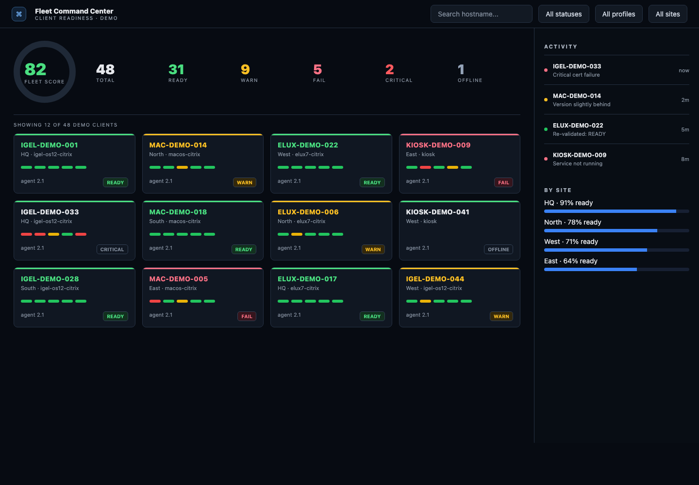
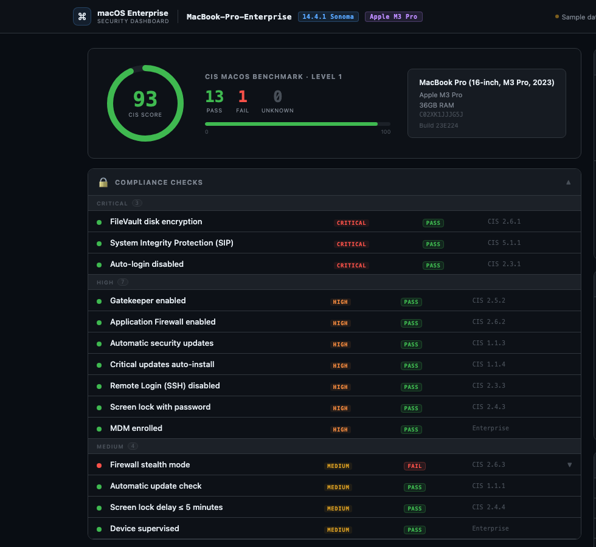
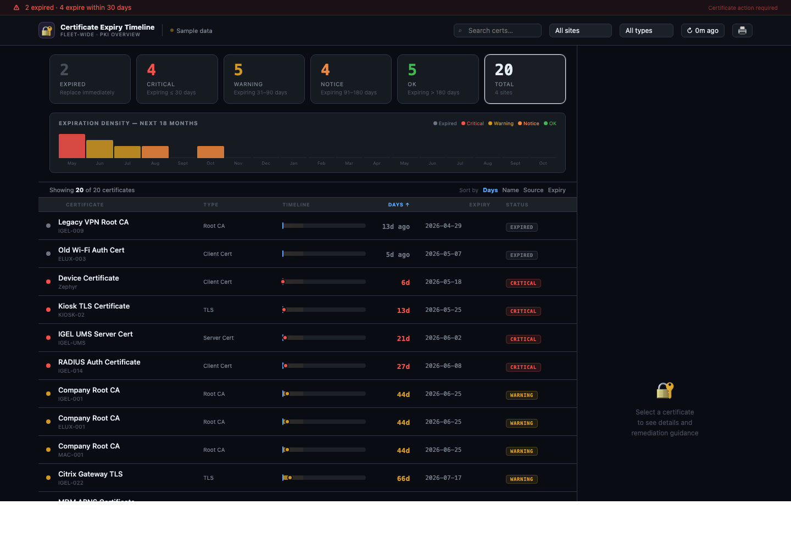
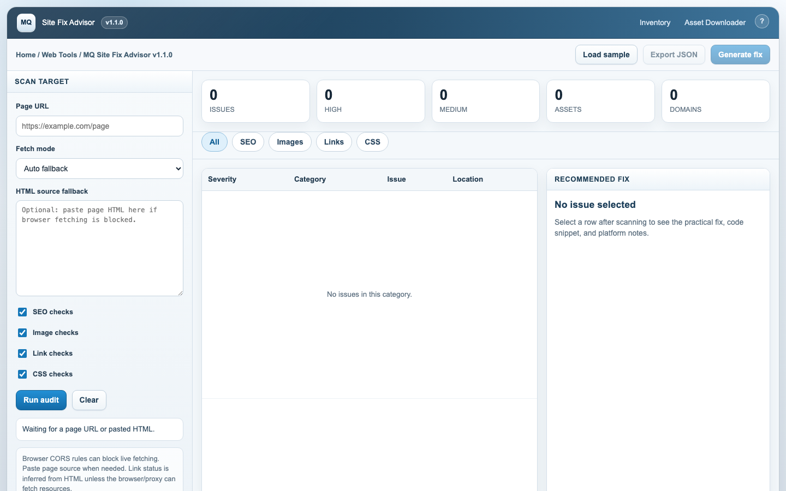
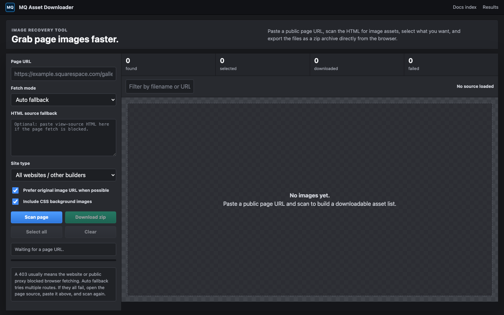
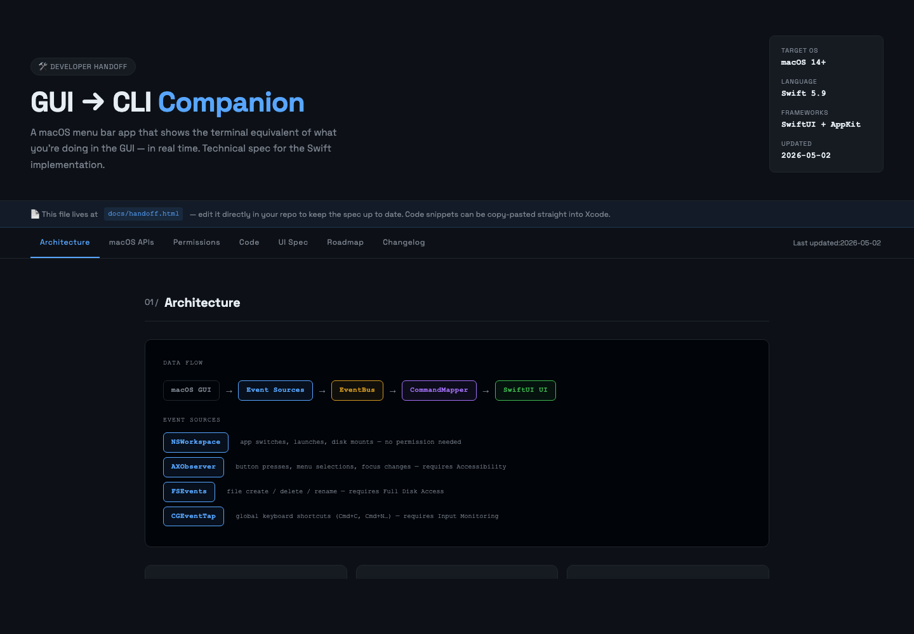
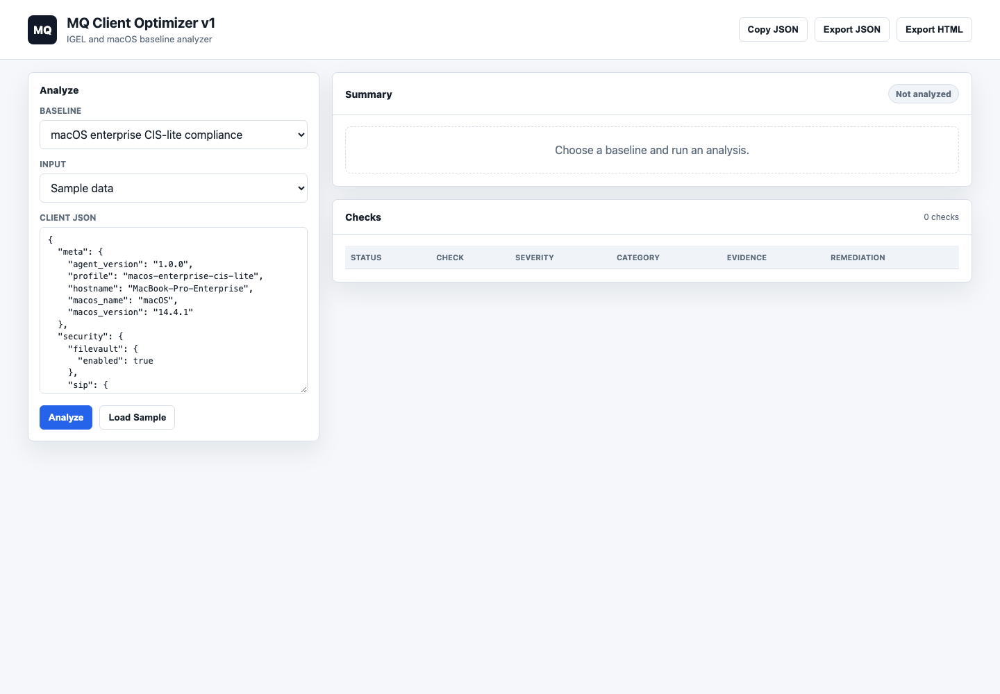

# Demo Gallery

Design-Prototype is a browser-based enterprise validation lab.

The goal is to make endpoint readiness, compliance, fleet visibility, certificate risk, and operator workflow ideas visible before they become production systems.

## Public demo front door

GitHub Pages:

```text
https://mcamner.github.io/Design-Prototype/
```

Local file:

```text
docs/index.html
```

## Demo catalog

| Demo | Purpose | File | Live helper | Demo fallback |
| --- | --- | --- | ---: | ---: |
| Client Readiness Dashboard | Validates endpoint readiness for Citrix/thin-client scenarios | `docs/Client Readiness Dashboard.html` | Yes | Yes |
| Fleet Command Center | Fleet-level readiness and endpoint visibility | `docs/Fleet Command Center.html` | Yes | Yes |
| macOS Enterprise Dashboard | macOS compliance, users, MDM, updates, and certificates | `docs/macOS Enterprise Dashboard.html` | Yes | Yes |
| Certificate Expiry Timeline | Certificate expiry risk visualization | `docs/Certificate Expiry Timeline.html` | Partial | Yes |
| MQ Fleet Report | Fleet-wide standalone report view | `docs/MQ Fleet Report.html` | No | Yes |
| MQ Client Optimizer | IGEL/macOS/Citrix readiness baseline evaluation | `docs/MQ Client Optimizer.html` | Yes | Yes |
| MQ Mirror | GUI-to-CLI workflow handoff | `docs/handoff.html` | Yes | No |
| MQ Site Fix Advisor | SEO, image, link, and CSS audit helper | `docs/MQ Site Fix Advisor.html` | No | Yes |
| MQ Asset Downloader | Image asset discovery and download workflow | `docs/MQ Asset Downloader.html` | No | Yes |


## Screenshots

Screenshots live in:

```text
docs/screenshots/
```

### Client Readiness Dashboard



### Fleet Command Center



### macOS Enterprise Dashboard



### Certificate Expiry Timeline



### MQ Site Fix Advisor



### MQ Asset Downloader



### MQ Mirror



### MQ Client Optimizer



## Screenshot checklist

Each screenshot should show:

- the main UI
- example data
- visible title/header
- no private hostnames
- no serial numbers
- no real usernames
- no internal IP addresses
- no certificates or sensitive identifiers

## Recommended screenshot names

```text
docs/screenshots/client-readiness-dashboard.png
docs/screenshots/fleet-command-center.png
docs/screenshots/macos-enterprise-dashboard.png
docs/screenshots/certificate-expiry-timeline.png
docs/screenshots/mq-fleet-report.png
docs/screenshots/mq-site-fix-advisor.png
docs/screenshots/mq-asset-downloader.png
docs/screenshots/mq-mirror.png
docs/screenshots/mq-client-optimizer.png
```

## Quick local demo commands

```bash
./tools/run-demo.sh list
./tools/run-demo.sh client
./tools/run-demo.sh fleet
./tools/run-demo.sh macos
./tools/run-demo.sh certs
./tools/run-demo.sh optimizer
./tools/run-demo.sh mqmirror
```

## Live helper commands

Client readiness helper:

```bash
python3 helper/client_readiness_agent.py
curl -s http://127.0.0.1:38765/status | python3 -m json.tool
```

macOS helper:

```bash
python3 helper/macos_agent.py
curl -s http://127.0.0.1:38764/status | python3 -m json.tool
```

Fleet collector:

```bash
python3 helper/fleet_collector.py
curl -s http://127.0.0.1:38766/status | python3 -m json.tool
```

MQ Mirror:

```bash
./tools/mqmirror/start.sh
```

## Safe sharing warning

Before sharing screenshots or helper output, review:

```text
docs/SAFE-SHARING.md
```

Recommended redaction command:

```bash
curl -s http://127.0.0.1:38764/status \
  | python3 tools/redact-macos-agent-status.py \
  | python3 -m json.tool
```

Sample data details:

```text
docs/SAMPLE-DATA.md
```

## Gallery completion checklist

```text
[ ] GitHub Pages front door opens
[ ] Every demo card link works
[ ] Demo Gallery links to every main prototype
[ ] Screenshots folder exists
[ ] At least one screenshot per major dashboard exists
[ ] README links to GitHub Pages front door
[ ] Safe-sharing warning is visible
[ ] Front-door check passes
```

## Publish target

The repo should be understandable in this order:

1. README
2. Demo Gallery
3. Project Map
4. Project Status
5. Individual prototype docs
